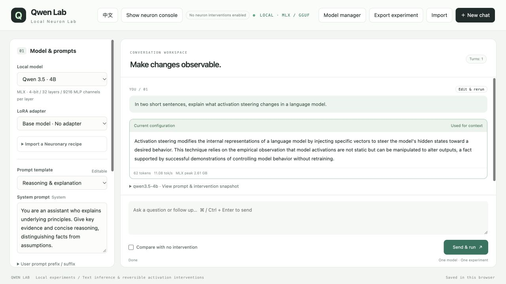
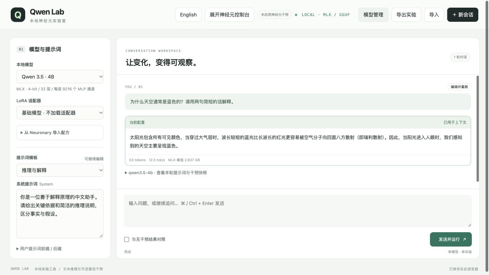

# Qwen Lab

**Local Qwen chat, visual neuron steering, and reproducible activation experiments on Apple Silicon.**
**在 Apple Silicon 上进行本地 Qwen 多轮对话、可视化神经元调节与激活干预对照实验。**

[English](#english) · [简体中文](#简体中文) · [MIT License](LICENSE) · [Qwen3.5-4B](https://huggingface.co/Qwen/Qwen3.5-4B) · [MLX 4-bit model](https://huggingface.co/mlx-community/Qwen3.5-4B-4bit)

No model weights are included. / 本仓库不包含模型权重。

## English



*English interface with a locally generated example response. No neuron intervention is enabled in this screenshot.*

### What is Qwen Lab?

Qwen Lab is a local research workbench with a bilingual web interface. Chat with local models, edit prompts, adjust multiple MLP channels, and compare unmodified and steered answers side by side. It is an independent community project, not an official Qwen product.

- **Local multi-turn chat:** streaming output, system/prefix/suffix prompts, editable history, reruns, and answer selection for subsequent context.
- **Visual neuron steering:** configure multiple layers and channels; scale activations or add residual-normalized offsets before `down_proj`. The console starts collapsed; collapsing it does not disable configured interventions.
- **Controlled comparisons:** baseline vs. intervention, calibration measurements, observed injection values, per-turn settings, and JSON experiment export/import.
- **Neuronary import:** preview a single public recipe, inspect compatibility, adjust its dose multiplier, and import its channels and an optional example prompt.
- **Model manager:** paste a public Hugging Face repository URL; inspect versions, download with pause/resume and integrity checks, then run a short load test.
- **English / 中文:** switch instantly; the browser remembers the language. Existing prompts, model replies, drafts, recipe text, and settings remain unchanged.
- **MLX LoRA tools:** example training data, a conservative training configuration, adapter selection, evaluation, and a separate OpenAI-compatible local API.

### Requirements and support

The supported installation target is **macOS on Apple Silicon (M-series)**, with Python 3.11 managed by [uv](https://docs.astral.sh/uv/). Node.js is only needed for frontend tests, not to run the app. Install `curl` if it is not already available.

The original development environment was an M4 Mac with 16 GB unified memory. A 4-bit 4B model is a practical starting point; memory use also depends on context length, output length, calibration, and training. Leave several GiB of free disk space for weights and downloads. Windows, Linux GPU inference, and Intel Macs are not supported by the setup script.

| Model format | Chat | Neuron steering / comparisons | LoRA |
|---|---|---|---|
| Compatible Qwen3.5 MLX quantized models | Yes | Yes, supported dense MLP architecture | Default 4B CLI configuration; other bases need their own config |
| Single-file GGUF via llama.cpp | Yes, if the engine supports the architecture | No | No |
| PyTorch checkpoints, sharded GGUF, images/video, remote model code | Not supported by this UI | — | — |

### Install and start

Install [uv](https://docs.astral.sh/uv/getting-started/installation/), then:

```bash
git clone https://github.com/IceThunder/qwen-lab.git
cd qwen-lab
bash scripts/setup.sh
bash scripts/web.sh
```

Open **http://127.0.0.1:7860/**. An empty model list is normal on a fresh install. The app does not download a model on startup. Keep the terminal open; **Ctrl+C** stops the service. Use `bash scripts/web.sh --port 7861` if needed. You do not need Ollama, vLLM, npm, or a separate API server for the web UI.

### Download Qwen3.5 4B

- Official upstream model: [Qwen/Qwen3.5-4B](https://huggingface.co/Qwen/Qwen3.5-4B).
- Recommended format for this app: [mlx-community/Qwen3.5-4B-4bit](https://huggingface.co/mlx-community/Qwen3.5-4B-4bit). The official PyTorch weights are **not** interchangeable with this MLX conversion.

For the default CLI, LoRA configuration, and Neuronary mapping, stop the web service and run:

```bash
bash scripts/download.sh
bash scripts/web.sh
```

The downloader pins a Hugging Face commit, resumes partial downloads, verifies file sizes and published LFS SHA256 hashes, and installs into `models/qwen3.5-4b/`. Interrupted downloads stay under `work/default-model/`; rerun the command to resume. Existing model folders are not overwritten. You can select a commit on a new download with `bash scripts/download.sh --revision <commit>`.

Alternatively, use **Model manager → repository URL → Read repository → Download & install → Test loading**. The default MLX repository receives the canonical `qwen3.5-4b` ID on its first installation; other models/versions receive separate IDs. Additional MLX models do not automatically gain recipe mappings or training configs. A successful load test covers only a short response.

For GGUF chat, install [llama.cpp](https://github.com/ggml-org/llama.cpp), for example `brew install llama.cpp`, before testing loading. Runtime discovery checks `LLAMA_SERVER`, then `.runtime/llama.cpp/`, then `llama-server` on `PATH`. Use a recent version supporting the model's architecture.

### Experiment workflow

1. Select a model and prompt template. Start with a short, unmodified answer.
2. Expand the neuron console, add groups, and set zero-based layer/channel IDs.
3. Choose **Scaling** (`activation × scale`) or **Normalized addition** (`activation + Δ`). Scaling by 0 disables the selected channel; additive dose 0 does nothing.
4. Enable baseline comparison and send a question. Review both answers, calibration, and the turn snapshot. Choose which answer continues the conversation.
5. Export important experiments as JSON. Sessions are stored in your browser, separately for each origin/port.

Normalized addition uses:

```text
Δ = dose × median(||residual leaving layer L||₂) / ||W_down[:, neuron]||₂
```

Calibration is an unsteered pass over the full current input. It skips the first token by default. Each selected channel's fixed Δ is applied to **all input and generated tokens** for that turn. Layers and channels are zero-indexed. This is an explicit implementation convention, not a guarantee of matching an external author's code or outputs.

Web generation supports **1–4096 new tokens** and **2048 / 4096 / 8192 context budgets**. Input tokens plus the requested output allowance must fit the budget. Thinking consumes the output budget. Temperature 0 uses greedy decoding. The lightweight CLI has a separate 1–1024 output limit.

Neuronary currently maps `Qwen/Qwen3.5-4B` recipes to the default `qwen3.5-4b` MLX installation. It does not infer compatibility from parameter counts. Website examples remain reference text; importing does not generate an answer. Temperature is applied, but unsupported sampling fields such as repetition penalty and top-p are only displayed. Large interventions can produce repetition or incoherence; reduce dose and compare against the baseline. There is no automatic anti-repetition correction.

### CLI, API, and fine-tuning

Run these from the project root after downloading the default model. Stop other model processes before training on a memory-limited machine.

```bash
# One-shot text inference
bash scripts/run.sh --prompt "Explain activation steering briefly." --max-tokens 128

# Compare channel scaling values
bash scripts/intervene.sh --layer 16 --neurons 0,1,2,3 --scales 0,1,2

# Separate OpenAI-compatible API at http://127.0.0.1:8080/v1
bash scripts/serve.sh
# In another terminal, from the project root:
.venv/bin/python scripts/call_api.py --prompt "Hello"

# Stop the API/Web, then run a small LoRA smoke training job
bash scripts/train.sh --iters 2 --val-batches 1 --steps-per-eval 2 \
  --save-every 2 --adapter-path adapters/qwen3.5-4b/my-experiment

# Evaluate the trained adapter
bash scripts/evaluate.sh --adapter-path adapters/qwen3.5-4b/my-experiment
```

`data/example/` contains tiny synthetic Chinese examples for checking the pipeline, not a useful training corpus. Edit `configs/qwen3.5-4b/lora.yaml` for real training. Adapters are specific to their base model; select them from the web UI after restarting it. Activation steering changes computation temporarily; it does not train or rewrite weights.

### Development, privacy, and scope

```bash
.venv/bin/python -m unittest discover -s tests -p 'test_*.py'
node tests/test_i18n.cjs
```

Numerical tests require MLX on Apple Silicon but do not load model weights. CI covers portable backend tests, download logic, and frontend translations; it does not benchmark inference. See [CONTRIBUTING.md](CONTRIBUTING.md).

Inference is local. Hugging Face downloads and Neuronary recipe reads require network access. The UI uses no external script/font CDN. The server binds to loopback and checks Host/Origin; it is a single-user local tool, not an authenticated public service. Experiment exports can contain prompts and replies. Models, adapters, runtime binaries, logs, caches, downloads, and private datasets are ignored by Git.

## 简体中文



*中文界面与本地模型生成的示例回答；截图未启用神经元干预。*

### 项目功能

Qwen Lab 是面向 Apple Silicon 的本地模型实验工具，提供中英文 Web 界面。支持多轮流式对话、系统提示词与用户前后缀、多层多通道神经元调节、无干预对照、逐轮配置快照、历史编辑重跑及实验导入导出。它是独立社区项目，并非 Qwen 官方产品。

- **神经元控制台**默认隐藏，可手动添加干预组；收起不会停止已启用的干预。支持乘法缩放与残差归一化加法，不再提供固定“原帖示例”快捷按钮。
- **Neuronary** 单条配方预览及导入，包含兼容性、剂量倍率、示例提示词、来源记录与未应用采样参数提示。
- **模型管理**支持公开 Hugging Face 仓库、版本选择、暂停续传、完整性校验和短文本测试加载。
- **English / 中文**切换会记住浏览器偏好，已有提示词、回答、草稿、网站原文及参数保持不变；主动选择模板时才填入对应语言版本。
- **LoRA 与 API**提供默认 4B 模型的训练、评估、适配器加载和独立 OpenAI 兼容 API 工具。

### 环境与安装

支持 **Apple Silicon（M 系列）macOS**。安装 [uv](https://docs.astral.sh/uv/getting-started/installation/) 后运行以下命令，脚本会建立 Python 3.11 环境并安装固定依赖。Node.js 仅用于前端测试，日常使用不需要。

```bash
git clone https://github.com/IceThunder/qwen-lab.git
cd qwen-lab
bash scripts/setup.sh
bash scripts/web.sh
```

打开 **http://127.0.0.1:7860/**，首次安装模型列表为空是正常现象。保持终端打开；按 **Ctrl+C** 关闭服务。端口冲突时使用 `bash scripts/web.sh --port 7861`。无需另外启动 Ollama、vLLM 或 `serve.sh`。

开发时使用 M4 / 16 GB 统一内存，建议从 4B 的 4-bit 版本开始；内存需求会随上下文、输出长度、校准及训练配置变化。预留数 GiB 磁盘空间。安装脚本暂不支持 Windows、Intel Mac 或 Linux GPU 推理。

### 下载模型（仓库不附带权重）

- 官方原始模型：[Qwen/Qwen3.5-4B](https://huggingface.co/Qwen/Qwen3.5-4B)。
- 本项目推荐：[mlx-community/Qwen3.5-4B-4bit](https://huggingface.co/mlx-community/Qwen3.5-4B-4bit)。官方 PyTorch 权重不能直接替代 MLX 转换版。

为了直接使用默认 CLI、LoRA 配置及 Neuronary 映射，停止 Web 后执行：

```bash
bash scripts/download.sh
bash scripts/web.sh
```

下载脚本固定提交版本，支持中断续传，检查文件大小和公开的 LFS SHA256；成功后安装到 `models/qwen3.5-4b/`，不会覆盖已有目录。未完成下载保存在 `work/default-model/`，重新运行可续传。新下载可用 `--revision <commit>` 指定提交。

也可在界面点 **模型管理 → 粘贴仓库链接 → 读取仓库 → 下载安装 → 测试加载**。默认 MLX 仓库首次安装使用 `qwen3.5-4b` 标识，其他模型或版本单独保存。新架构不一定兼容，新增模型不会自动获得 LoRA 配置和配方映射。

GGUF 使用 llama.cpp，只支持文本对话，不支持当前神经元干预、对照和 LoRA。可先执行 `brew install llama.cpp`；运行时依次从 `LLAMA_SERVER`、项目 `.runtime/llama.cpp/`、系统 `PATH` 查找。引擎版本必须支持模型架构。

### 使用与实验约定

选择模型后先运行无干预基线，再展开控制台添加组。层号、通道从 0 开始；乘法 `scale=0` 关闭通道，归一化加法 `dose=0` 表示不注入。加法公式为 `Δ = dose × 层输出残差范数中位数 / down_proj 对应权重列范数`。每轮先对完整输入做无干预校准，默认跳过首 token，固定 Δ 随后应用于该轮全部输入和生成 token。干预是临时计算修改，不会更改权重文件。

Web 生成上限 **1–4096 token**，上下文预算 **2048 / 4096 / 8192**；输入与输出预留之和不能超出预算，思考也占生成预算。温度 0 为贪心解码。CLI 的单次输出限制单独设为 1–1024。

Neuronary 当前只映射官方 Qwen3.5-4B 配方到默认 MLX 模型。网站回答不会写入本地历史；导入不会自动发送。温度会应用，但重复惩罚、top-p 等未支持字段仅展示，不构成精确复现。剂量过大可能引起重复与语义退化，可降低剂量并查看对照；当前没有自动防重复修正。

重要实验请导出 JSON。聊天记录存在浏览器中，不同地址和端口各自独立。训练与 API 命令见上方英文示例及下方中文详细文档；演示训练数据只用于流程验证，不代表训练质量。

### 中文文档

- [首次安装、运行与停止](docs/QUICKSTART_ZH.md)
- [Web、提示词与神经元控制完整说明](docs/WEB_UI.md)
- [模型管理、下载与测试加载](docs/MODEL_MANAGER_ZH.md)
- [Neuronary 导入及兼容性](docs/NEURONARY_ZH.md)
- [命令行、API 与 LoRA 微调](docs/USAGE_ZH.md)

## Repository layout / 目录结构

```text
qwen-lab/
├── README.md                    # English + 简体中文
├── LICENSE                      # MIT (code / 代码)
├── CONTRIBUTING.md              # Development / 开发说明
├── requirements.lock.txt        # Pinned Python dependencies / 固定依赖
├── .gitignore                   # Excludes local artifacts / 排除本地产物
├── .github/workflows/ci.yml     # Portable tests / 自动检查
├── web/
│   ├── server.py                # Loopback HTTP server / 本机服务
│   ├── backend.py               # Jobs, discovery, MLX / 任务与推理
│   ├── steering.py              # Activation calibration / 干预校准
│   ├── gguf_backend.py          # llama.cpp process / GGUF 引擎
│   ├── model_manager.py         # HF downloads / 模型管理
│   ├── neuronary.py             # Public recipe import / 配方导入
│   └── static/                  # index.html, style.css, app.js,
│                                # model-manager.js, i18n.js, i18n-catalog.js
├── scripts/                     # setup, download, web, run, serve,
│                                # intervene, train, evaluate, API client
├── configs/qwen3.5-4b/lora.yaml  # Example LoRA config / 训练配置
├── data/example/                # Synthetic train/valid/test JSONL / 演示数据
├── tests/                       # Backend, numerical, i18n tests / 测试
└── docs/                        # Usage guides / 使用文档
    └── images/                  # English / 中文界面示例截图
```

Created locally and **not committed** / 以下目录运行时生成，**不提交**：
`models/`, `adapters/`, `outputs/`, `logs/`, `work/`, `.venv/`, `.runtime/`, `.cache/`.

## License & credits / 许可与致谢

Project code is licensed under [MIT](LICENSE). Models, third-party packages, and downloaded recipe content retain their own licenses and terms; the MIT license does not relicense them. / 项目代码使用 MIT，模型、第三方依赖和下载配方遵循各自许可。

Built with [MLX](https://github.com/ml-explore/mlx), [MLX LM](https://github.com/ml-explore/mlx-lm), [llama.cpp](https://github.com/ggml-org/llama.cpp), [Hugging Face](https://huggingface.co/), and the [Qwen](https://github.com/QwenLM) ecosystem. Recipe integration: [Neuronary](https://neuronary.org/).

## Topics / 检索关键词

`qwen` · `qwen3-5` · `qwen-lab` · `mlx` · `apple-silicon` · `local-llm` · `neuron-steering` · `activation-steering` · `mechanistic-interpretability` · `llama-cpp` · `gguf` · `lora` · `huggingface` · `neuronary` · `bilingual`
本地大模型 · 神经元可视化 · 激活干预 · 可解释性 · 对照实验 · 模型管理 · LoRA 微调 · 中英文界面
